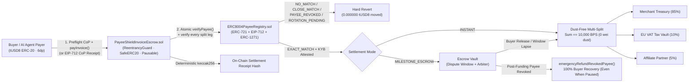

# PayeeShield — ERC-8004 Confirmation-of-Payee & `tUSD8` Merchant Invoice Escrow

> **Built for [Aevum Builder Challenge #1](https://dorahacks.io/hackathon/qday) on QDay Aevum Testnet (Chain ID `44005`)**  
> **Tracks:** Confirmation of Payee (CoP) · Invoice Payments (`tUSD8` · 6 decimals)

**PayeeShield** brings UK Pay.UK / EU Verification-of-Payee (VoP) security guarantees on-chain for B2B stablecoin invoices and autonomous AI agent payments. Before a **single base unit of `tUSD8`** moves, PayeeShield cryptographically verifies the merchant's **ERC-8004 Identity NFT**, strict ASCII normalized handle, legal entity hash, active `agentWallet`, KYB attestation status, wallet-rotation cooldown state, and every secondary multi-party split recipient — hard-reverting spoofed, hijacked, or revoked payees with `0 wei` lost.

---

## Architecture Overview



---

## Verified QDay Aevum Testnet Configuration

Verified directly against live QDay Aevum JSON-RPC (`eth_chainId = 0xabe5`, `eth_getCode`, ERC-20 `name`/`symbol`/`decimals`, and Blockscout v2 API):

| Parameter | Verified Live Value |
| :--- | :--- |
| **Network Name** | `QDay Aevum Testnet` |
| **Chain ID** | `44005` (`0xabe5`) |
| **Public RPC URL** | `https://rpc-test.qday.info` |
| **Block Explorer** | `https://explorer-test.qday.info` |
| **EVM Compilation Target** | `shanghai` (verified against live Aevum Blockscout contracts) |
| **Native Gas Token** | `tQDAY` (18 decimals) |
| **Official `tUSD8` Contract** | [`0x456569838f1d43009A91ebA4263147Afd7233483`](https://explorer-test.qday.info/address/0x456569838f1d43009A91ebA4263147Afd7233483) (EIP-1967 Proxy, `6` decimals) |
| **Official QDay Faucet** | `https://faucet.qday.info` (Contract `0xE5074CBbd046AFb491EB8692abD6cF7ECCC6dEE5`, human Cloudflare Turnstile / reCAPTCHA gated; Discord backup `https://discord.gg/bYPhjmrSfK`) |
| **Canonical ERC-8004 Singleton** | Not pre-deployed at Ethereum canonical `0x8004A169...` on `44005` (`eth_getCode = 0x`) — PayeeShield ships a fully spec-compliant `ERC8004PayeeRegistry.sol` |

---

## Security & Threat Model Coverage

| Threat Vector | PayeeShield On-Chain & dApp Defense |
| :--- | :--- |
| **Business Email Compromise (BEC) / Invoice Address Swap** | Buyer supplies `expectedHandleHash`, `expectedLegalHash`, `expectedPayoutWallet`; contract cross-checks both immutable invoice params AND live ERC-8004 registry (`BuyerExpectationMismatch` / `PayeeMismatch`). |
| **Unicode / Cyrillic Homoglyph & Lookalike Spoofing** | `ERC8004PayeeRegistry.normalizeHandle` enforces strict lowercase ASCII `[a-z0-9._-]` (rejects U+0430 Cyrillic `а` etc. at Solidity level); dApp visual-skeleton & Levenshtein detector warns on lookalikes (`acrne.cloud` vs `acme.cloud`). |
| **Silent Account Takeover / Instant Wallet Hijack** | `setAgentWallet` requires EIP-712 / ERC-1271 consent signature from `newWallet` + per-agent nonce + **timelocked rotation cooldown** (`rotationCooldown`); `strictNoPendingRotation` blocks settlement during cooldown; guardian can cancel hijack. |
| **ERC-8004 Identity NFT Transfer Hijack** | ERC-721 `_update` hook automatically zeroes `agentWallet` and pending rotations on transfer so prior owners can never intercept future payments. |
| **Post-Funding Payee Compromise** | `releaseEscrow` & `finalizeEscrow` re-verify live CoP; if payee (or any split leg) is revoked after funding, buyer can immediately reclaim **100% of escrowed `tUSD8`** via `emergencyRefundRevokedPayee()` — even while the contract is paused. |
| **EIP-712 Receipt Spoofing & Replay** | `payInvoiceWithCoPProof` verifies EIP-712 domain-bound (`chainId = 44005`) signatures from `ATTESTER_ROLE` or active payee wallet (EOA + ERC-1271) and burns every digest in `usedCoPReceipts[digest]`. |
| **Rounding Dust & Split Invariant Bypass** | Enforces `1 <= splits.length <= 8`, every leg `> 0 bps`, `sum == 10_000`, every split recipient ERC-8004 active & unrevoked; assigns `amount - distributed` to the final leg (**0 wei dust**, verified from `1` base unit up to `$1,000,000,000.999999 tUSD8`). |
| **Reentrancy on Malicious Token Callbacks** | `ReentrancyGuard` + strict Checks-Effects-Interactions (CEI) verified against adversarial `ReentrantTUSD8` attack hooks across `payInvoice`, `releaseEscrow`, and `emergencyRefundRevokedPayee`. |

---

## Repository Layout

```text
aevum-payeeshield/
├── contracts/
│   ├── interfaces/IERC8004PayeeRegistry.sol   # ERC-8004 + CoP standard interface
│   ├── ERC8004PayeeRegistry.sol               # Full ERC-8004 NFT Identity + CoP + EIP-712/ERC-1271 + Cooldown + Attestations
│   ├── PayeeShieldInvoiceEscrow.sol           # tUSD8 CoP-gated Instant & Milestone Escrow + Multi-Party BPS Splits
│   └── mocks/
│       ├── MockTUSD8.sol                      # 6-decimal test token (local tests only)
│       ├── ReentrantTUSD8.sol                 # Adversarial reentrancy test double
│       └── MockERC1271Wallet.sol              # Smart-account EIP-1271 verification mock
├── test/
│   └── PayeeShield.test.js                    # 38 unit & adversarial security tests (100% PASS)
├── scripts/
│   ├── generate-deployer.mjs                  # Creates gitignored .env deployer wallet (never prints private key)
│   ├── deploy.mjs                             # One-command live Aevum Testnet (44005) deployment + web config sync
│   ├── verify-blockscout.mjs                  # Blockscout source verification for Chain ID 44005
│   ├── deploy-hardhat.js                      # Local end-to-end CoP settlement proof
│   └── e2e_smoke.py                           # Playwright Desktop (1440×900) + Mobile (390×844) E2E test
├── web/                                       # Static React + Vite + ethers v6 dApp (GitHub Pages ready)
│   ├── src/config/aevum.js                    # Chain ID 44005 & official tUSD8 configuration + ABIs
│   ├── src/engine/copEngine.js                # Interactive Simulation Engine mirroring Solidity invariants
│   ├── src/hooks/useAevumWallet.js            # EIP-1193 MetaMask connector + auto wallet_addEthereumChain(44005)
│   └── src/App.jsx                            # CoP Inspector · Invoice Queue · Split Builder · ERC-8004 Registry
├── hardhat.config.js                          # Solidity 0.8.26 (evmVersion: shanghai, viaIR: true)
└── .env.example                               # Template config (real .env is strictly gitignored)
```

---

## Quick Start & Verification Proofs

### 1. Install & Run Smart Contract Security Suite (**38/38 PASS**)

```bash
npm install
npm test
```

Latest verified test run (`evm target: shanghai`, OpenZeppelin `5.1.0`, zero Cancun opcodes):
- **1. ERC-8004 Identity Registry, CEI `_safeMint` Guard, KYB Epochs & Homoglyph Defense** — `9/9 PASS`
- **2. Confirmation-of-Payee Pre-Flight & Settlement Gate** — `7/7 PASS`
- **3. EIP-712 CoP Receipts, ERC-1271 Smart Wallets & Cross-Escrow Replay Defense** — `4/4 PASS`
- **4. Multi-Party BPS Splits, 0-Wei Dust & $1B Overflow Invariants** — `5/5 PASS`
- **5. Milestone Escrow, Disputes (Paused-Safe), Rotation Lock & Zero-Stuck-Funds Emergency Exit** — `8/8 PASS`
- **6. Adversarial Reentrancy, RBAC Access Control, Zero-Hash Rejection & Pause Circuit Breaker** — `5/5 PASS`
- **Total: `38 passing (2s)`**

### 2. Local End-to-End Settlement Proof

```bash
npm run deploy:local
```

Verified output:
- `Spoofed Payout Blocked  : true`
- `Merchant (85%) + TaxVault (10%) + Affiliate (5%) = 10,625.000002 + 1,250.000000 + 625.000001 = 12,500.000003 tUSD8`
- `Escrow Dust Remaining   : 0`

### 3. Build & Run Static Web dApp + Playwright E2E (**0 Console Errors**)

```bash
npm run web:install
npm run web:build
npm run e2e
```

Verified output:
- Vite production bundle (`web/dist/`) built cleanly in `2.15s` (`base: "./"`, ready for GitHub Pages).
- Playwright E2E (`scripts/e2e_smoke.py`) passed all interactive flows across **Desktop (`1440×900`)** and **Mobile (`390×844`, zero horizontal overflow)** with **0 console errors and 0 page errors**.
- Includes **Interactive Simulation Mode** (instant 10-second judge demo with zero wallet/gas friction) AND **Aevum Live Mode (Chain ID `44005`)** with automatic MetaMask `wallet_addEthereumChain` setup.

### 4. One-Command Live Deployment to QDay Aevum Testnet (`44005`)

> **Live Deployment Status:** Official QDay Faucet (`https://faucet.qday.info`) enforces human Cloudflare Turnstile / reCAPTCHA verification (not bypassed). A fresh uncommitted local deployer wallet (`0xB15f90BaB6BBc6f090D7522c4CFf3070CaFac856`) is ready in local gitignored `.env`, and `npm run deploy:aevum` has been live-tested against `https://rpc-test.qday.info` (verified Chain ID `44005` and live `tUSD8` contract bytecode at `0x456569838f1d43009A91ebA4263147Afd7233483`).

Once funded with `tQDAY` gas via [faucet.qday.info](https://faucet.qday.info) (or [QDay Discord](https://discord.gg/bYPhjmrSfK)):

```bash
npm run wallet:new      # Generates local uncommitted .env deployer (prints public address only)
npm run deploy:aevum    # Deploys ERC8004PayeeRegistry + PayeeShieldInvoiceEscrow targeting live tUSD8
npm run verify:aevum    # Verifies both contracts on https://explorer-test.qday.info
npm run web:build       # Rebuilds static web/dist with live deployed contract addresses
```

---

## License

MIT License — see [LICENSE](./LICENSE).
